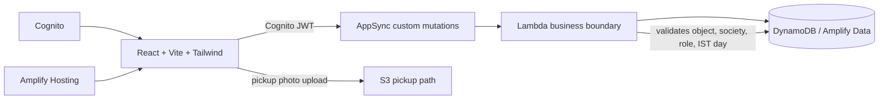

# Punarnav

Punarnav is a MyGate-style waste-verification MVP for Indian housing societies. A collector verifies a wet/dry bin at the flat door; the **flat** earns points and a verified-segregation streak. The collector earns the same two points for every completed pickup, regardless of their rating.

## Architecture



## Security contract

- The schema grants clients read-only access to business models. Rating, ledger, redemption, dispute, and admin changes are custom Lambda mutations.
- Lambdas must derive identity and group from the Cognito JWT, resolve the caller's active `UserProfile`, and condition every DynamoDB operation on the resolved `societyId`.
- Public sign-up is resident-only and produces a `PENDING` profile. Elevated groups are admin-invite-only and server assigned.
- Ledger rows are append-only. A correction is a reversal plus a new row, both in one transaction.
- Every data-changing admin action writes `AuditLog` in the same transaction.
- Rate transactions use an IST `flatId#date` conditional key. A second rate returns the original read-only pickup.

## Local setup

```bash
npm install
npx ampx sandbox
npm run dev
```

Copy the sandbox-generated `amplify_outputs.json` into the project root before connecting the browser to AWS. Configure Amplify in the entrypoint using those outputs before deploying a live environment.

## Operator workflow

1. Run `npm run bootstrap` with AWS credentials and sandbox outputs. It must create the first society, towers, active flats, and first admin through the server-only operator flow.
2. Sign in as the admin, approve pending residents, and invite collectors/admins. Temporary-password users complete the Cognito forced password change flow.
3. Run `npm run seed:demo` only in a demo environment. It is deliberately separate from bootstrap.
4. Deploy with Amplify Hosting after the backend has been deployed: `npx ampx pipeline-deploy --branch main --app-id <app-id>`.

## Required demo fixture

The demo seed must make one society, four towers, 40 flats (two vacant), three collectors, 25 residents, 14 IST days of varied pickup history, four rewards, two open disputes, an improving tower, and a collector with 100% GREEN history. Store demo credentials outside source control and expose them only in the hackathon demo environment.

## Authorisation checklist

| Role | Allowed | Must be denied |
| --- | --- | --- |
| Resident | Read own society data, raise one timely dispute, redeem own flat balance | Rating, ledger writes, other-flat data, elevated roles |
| Collector | Read society route, rate an active flat once per IST day | Rating own work twice, cross-society paths, points edits |
| Admin | Invite/approve/deactivate, resolve/override, manage rewards/flats | Unlogged direct writes, cross-society access |

Test each row with separate Cognito users and assert AppSync returns `UNAUTHORIZED` for forbidden direct mutations.

## Known verification limits for this handoff

The project source and interactive UI shell were written in this session, but the execution environment repeatedly failed before it could start **any** PowerShell process (`helper_unknown_error: setup refresh had errors`). Consequently I could not run `npm install`, `ampx sandbox`, TypeScript, lint, tests, seed/bootstrap, camera/S3 flows, or deployment. The Lambda file currently documents/enforces input and JWT checks but still needs its DynamoDB transactional repository implementation and live Amplify output wiring before it meets the full production brief. Do not treat this build as deployment-verified.
